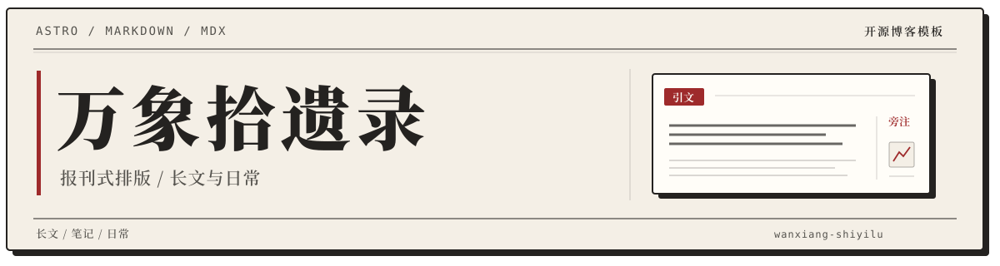
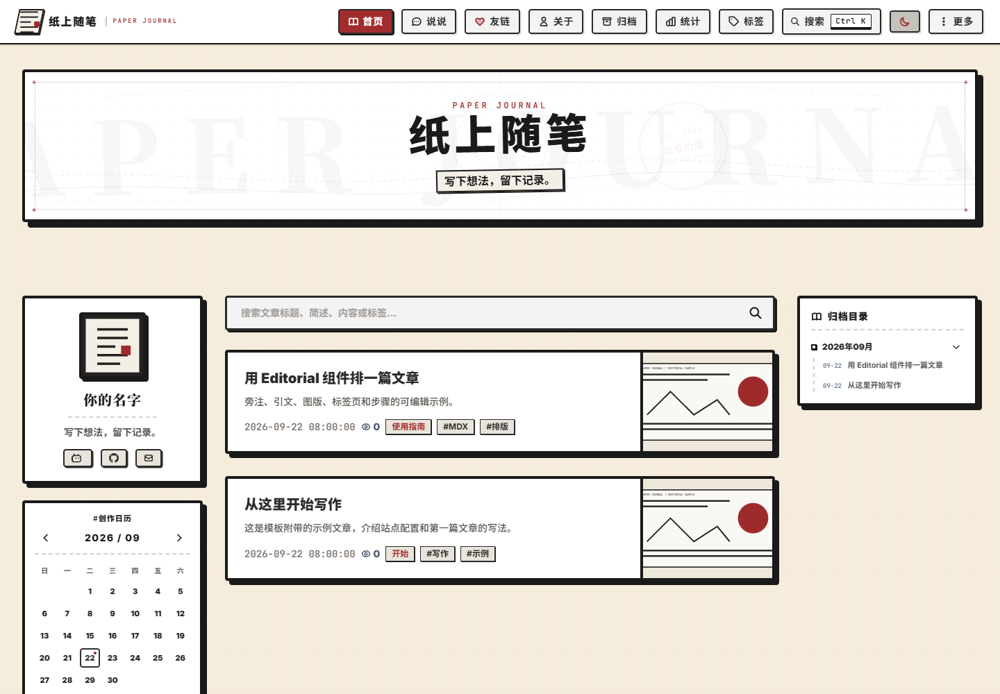
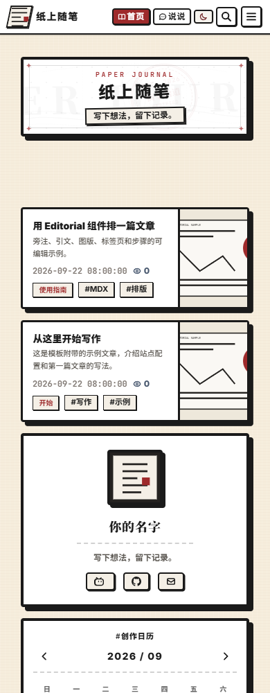
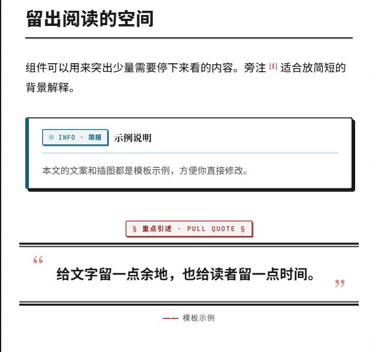
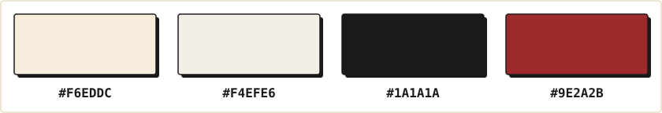

<a name="readme-top"></a>

<p align="center">
  <picture>
    <source media="(prefers-color-scheme: dark)" srcset="docs/images/readme-cover-dark.svg" />
    
  </picture>
</p>

<p align="center"><strong>An Astro blog template with the character of a printed journal.</strong></p>

<p align="center">
  <a href="https://github.com/Gnix807/wanxiang-shiyilu-template/generate"></a>
  <a href="https://github.com/Gnix807/wanxiang-shiyilu-template/actions/workflows/build.yml"></a>
  <a href="LICENSE"></a>
</p>

<p align="center">
  <a href="package.json"></a>
  <a href="tsconfig.json"></a>
  <a href="package.json"></a>
  <a href="#quick-start"></a>
  <a href="package.json"></a>
</p>

<p align="center">
  <a href="https://omnigazette.dev">Author&#x27;s blog</a> ·
  <a href="#quick-start">Quick start</a> ·
  <a href="#editorial-components">Components</a> ·
  <a href="#deploy-to-cloudflare-pages">Deployment</a> ·
  <a href="#faq">FAQ</a> ·
  <a href="README.md">简体中文</a>
</p>

Wanxiang Shiyilu brings journal-style headings, red labels, sidenotes and figures to a static blog. Use it for tutorials, essays, reading notes and everyday writing. Start from the example site, write in Markdown or MDX, and shape the pages as you go.

## Reading view

<a href="docs/images/preview-desktop.png"></a>

<details>
<summary>View the mobile layout</summary>

<p align="center"></p>

</details>

<p align="center"><sub>The included Paper Journal example site · <a href="https://omnigazette.dev">Visit the author's blog ↗</a></sub></p>

## Writing and reading

<table>
<tr>
<td width="50%" valign="top">

**Editorial layout**

Add quotes, sidenotes, figures, tabs and steps in MDX. Keep background material close to the text it supports.

[Explore the components →](#editorial-components)

</td>
<td width="50%" valign="top">

**Reading experience**

Themes, a table of contents, site search and an image lightbox support reading on desktop and mobile.

[See the reading view →](#reading-view)

</td>
</tr>
<tr>
<td width="50%" valign="top">

**Content organisation**

Articles and short posts have their own sections, with categories, tags, archives, a writing calendar and RSS / Atom feeds.

[Write your first article →](#write-your-first-article)

</td>
<td width="50%" valign="top">

**Static publishing**

Build pages from Markdown / MDX, use the bundled local fonts and publish to Cloudflare Pages.

[Read the deployment guide →](#deploy-to-cloudflare-pages)

</td>
</tr>
</table>

> [!NOTE]
> The template includes two articles, one short post and SVG artwork. Comments, analytics, weather and profile requests stay off until you configure them.

<details>
<summary>View the feature list and setup requirements</summary>

| Feature | Default state | Usage |
| --- | --- | --- |
| Markdown / MDX and Editorial components | Included | Import quotes, sidenotes, figures, steps and other components as needed |
| Categories, tags, archives and writing calendar | Included | Browsing entries come from the content collections |
| Article list filtering | Included | Matches titles, descriptions, categories and tags |
| Themes, table of contents and lightbox | Included | Reading and image viewing tools |
| RSS / Atom feeds | Included | Subscribe to all content, one content type or recent entries |
| Waline comments | Unconfigured | Requires your Waline server |
| Umami / Clarity and visit statistics | Unconfigured | Set your identifiers or compatible endpoints |
| GitHub / Bilibili profiles | Unconfigured | Set your accounts; sync the Bilibili video list manually |
| Welcome message and weather | Disabled | Enable the welcome message; weather needs a compatible endpoint |

AI model lists are retained configuration fields. Standard pages do not currently integrate summary or chat interfaces. See the [configuration guide](docs/configuration.en.md#4-enable-services-as-needed) for optional services.

</details>

## Quick start

Use **Node.js 24** and **pnpm 11.2.2** to match CI.

1. Select [Use this template](https://github.com/Gnix807/wanxiang-shiyilu-template/generate) to create your repository.
2. Clone that repository and open its root directory.
3. Install dependencies and start the site:

```sh
pnpm install --frozen-lockfile
pnpm dev
```

Open the local URL printed in the terminal. Update the site details, replace the examples, then build and publish.

See the [configuration guide](docs/configuration.en.md) for each setting and the [writing guide](docs/writing.en.md) for complete article and short-post examples.

### Make it yours

| Location | What to change |
| --- | --- |
| [src/config/site.ts](src/config/site.ts) | Site name, author, navigation, social links and optional services |
| [src/config/about.md](src/config/about.md) | About page text |
| [src/config/friends.json](src/config/friends.json) | Friend links; empty by default |
| [public/avatar.svg](public/avatar.svg) | Site and author avatar |
| [src/content/posts](src/content/posts), [src/content/talks](src/content/talks) | Example articles and short posts |
| [.env.example](.env.example) | Use this file to create `.env` and set your `PUBLIC_SITE_URL` |

Use a full HTTPS URL for `PUBLIC_SITE_URL`, without a trailing slash. Replace the example name, email and `example.com` values before launch. Use your own domain if you add a Sitemap entry to [robots.txt](public/robots.txt).

Enable comments and analytics as needed, and update the [privacy notice](src/pages/privacy.astro). Do not prefix secrets with `PUBLIC_`.

## Editorial components

<p align="center"><a href="docs/images/preview-editorial.jpg"></a></p>

<p align="center"><sub>Note and PullQuote in the example article · <a href="src/content/posts/2026-09-22-editorial-components.mdx">View the example source ↗</a></sub></p>

| Content | Components |
| --- | --- |
| Quotes, sidenotes and callouts | `PullQuote`, `Sidenote`, `Note` |
| Figures, image groups and references | `Plate`, `ImageGrid`, `LinkCard`, `SmartLink` |
| Guides, processes and timelines | `Tabs`, `Steps`, `Timeline` |
| Notes, poetry and dialogue | `Notebook`, `Poetry`, `Dialogue`, `Chat` |
| Inline labels and controls | `Badge`, `Kbd`, `Spoiler`, `Button` |

Import what you need after the Frontmatter in an MDX file:

```mdx
import { Note, PullQuote } from '../../components/editorial';

<Note title="Reading note">

Put useful background here and let the main text move on.

</Note>

<PullQuote source="Example">

Leave room for the words, and time for the reader.

</PullQuote>
```

Both Markdown images and `Plate` figures support the lightbox. See the [component directory](src/components/editorial) for all exports.

### Write your first article

Create a `.md` or `.mdx` file in `src/content/posts/`. Use a name such as `YYYY-MM-DD-slug.mdx` and add Frontmatter:

```yaml
---
title: My first article
description: A short article summary.
date: '2026-10-15'
tags: [Notes]
category: Life
img: /images/editorial-sample.svg
preserveHeadingLevels: true
---
```

The layout shows the article title, so start body headings at H2 (`##`). Set `preserveHeadingLevels: true` to keep source heading levels. Older articles without this field retain the rule that shifts headings down one level. Chinese prose uses 「」 and 『』 for quotations.

Short posts go in `src/content/talks/`. Start from the [example short post](src/content/talks/2026-09-22-hello.md).

The [writing guide](docs/writing.en.md) covers image credits, cover URLs and MDX import paths.

## Deploy to Cloudflare Pages

Build and preview the site locally:

```sh
pnpm build
pnpm preview
```

Once the pages look right, connect your GitHub repository to Cloudflare Pages:

| Setting | Value |
| --- | --- |
| Production branch | `main` |
| Framework preset | Astro |
| Build command | `pnpm build` |
| Output directory | `dist` |
| Node.js / pnpm | `24` / `11.2.2` |
| `PUBLIC_SITE_URL` | Your public site URL |

[wrangler.toml](wrangler.toml) sets the static output directory. Change its project name before use. GitHub Actions checks the build and saves its output; the connected Pages project handles deployment. See the [deployment guide](docs/deployment.md) for the full steps.

## Optional Bilibili videos

Set `socials.bilibiliMid` and `socials.bilibili` in `src/config/site.ts`, then run:

```sh
pnpm sync:bili
```

Review `src/data/bilibili-videos.json` and `src/data/bilibili-cache.json` before building. Both caches and the account are empty by default, so no Bilibili requests are made.

Builds read static data. The browser refreshes cards near the viewport through JSONP, reuses results for one hour and cleans up requests on navigation. Authored titles, descriptions and covers take priority. Failed syncs keep the existing list.

## Subscribe to updates

Append one of these paths to your site's domain and add the resulting URL to your feed reader:

| Feed | Path | Content |
| --- | --- | --- |
| [Site RSS](src/pages/rss.xml.ts) | `/rss.xml` | Articles and short posts |
| [Article RSS](src/pages/posts.xml.ts) | `/posts.xml` | Articles only |
| [Short-post RSS](src/pages/talk.xml.ts) | `/talk.xml` | Short posts only |
| [Latest entries](src/pages/latest.xml.ts) | `/latest.xml` | The 10 most recent articles and short posts |
| [Site Atom](src/pages/atom.xml.ts) | `/atom.xml` | Articles and short posts in Atom format |

Feeds generate public links from `PUBLIC_SITE_URL`. Set it to your domain before publishing.

## Design conventions

<p align="center"></p>

| Role | Light theme value | Use |
| --- | --- | --- |
| Paper background | `#F6EDDC` | Page background |
| Paper contrast | `#F4EFE6` | Labels and secondary surfaces |
| Ink | `#1A1A1A` | Text, solid borders and offset shadows |
| Vermilion | `#9E2A2B` | Links, seals and emphasis |

Serif headings and quotes use Noto Serif SC. Body and interface text use Inter / Noto Sans SC; code uses JetBrains Mono. Editorial panels, controls and small labels use 4 / 3 / 2 px corner radii.

Theme and font settings start in [src/index.css](src/index.css); shared body styles live in [editorial-components.css](src/styles/editorial-components.css). Adjust colors, fonts and borders together, then check both themes and nested components.

<details>
<summary>Command reference and project layout</summary>

| Command | Purpose |
| --- | --- |
| `pnpm dev` | Start local development |
| `pnpm build` | Check MDX and fonts, update the commit index and build |
| `pnpm preview` | Preview the build |
| `pnpm lint` | Run TypeScript checks |
| `pnpm check:assets` | Check font files and licenses |
| `pnpm check:mdx` | Check the MDX style dependency |
| `pnpm commit-index` | Update the article commit index |
| `pnpm sync:bili` | Sync videos for the configured account |

The stack uses Astro, TypeScript, React, Svelte and Tailwind CSS.

```text
src/components/   Page and Editorial components
src/config/       Site, author, about page and friend links
src/content/      Articles and short posts
src/layouts/      Page layouts
src/pages/        Routes and feeds
src/styles/       Styles and font definitions
public/           Images, fonts and other static files
scripts/          Build checks and data generation
docs/             Deployment and validation notes
```

Build output goes to `dist/`. Keep `src/data/commit-index.json` in version control because pages use it. Builds update it from the current repository. GitHub API history fetching is off by default.

After removing an article locally, use a new output directory or remove its old output by hand. This avoids stale preview pages. CI and Pages use clean checkouts.

</details>

## FAQ

<details>
<summary>Can I write in plain Markdown?</summary>

Yes. Articles can use `.md` or `.mdx`. Use Markdown for regular posts and MDX when you need components such as quotes or sidenotes. See [your first article](#write-your-first-article).

</details>

<details>
<summary>Do I need a database or a server to maintain?</summary>

Articles and short posts live in the repository. Builds produce static pages that Cloudflare Pages can host. External services such as comments and analytics are optional; the example site runs without them.

</details>

<details>
<summary>Why does an open-source template set private: true?</summary>

The `private: true` flag in `package.json` prevents accidental npm publication. It does not affect the open-source code, the GitHub template feature or site deployment.

</details>

## Guides

| Guide | When to read it |
| --- | --- |
| [Configuration](docs/configuration.en.md) | Change site details, navigation, author profile and optional services |
| [Writing](docs/writing.en.md) | Create articles and short posts, add covers and use components |
| [Deployment](docs/deployment.md) | Set up Cloudflare Pages and the build environment; this guide is in Chinese |

## Help and contributions

Report problems through [Issues](https://github.com/Gnix807/wanxiang-shiyilu-template/issues). Include steps to reproduce, your environment and relevant logs. Screenshots help with layout issues.

Run `pnpm lint` and `pnpm build` before opening a pull request. Include desktop and mobile screenshots for visual changes. The [validation record](docs/validation.md) describes the checks so far.

This repository also accepts [friend-link requests for the author's blog](https://github.com/Gnix807/wanxiang-shiyilu-template/issues/new?template=friend-request.yml). When you create your own site, update `.github/ISSUE_TEMPLATE/friend-request.yml` and the link on the friends page.

## Credits and license

This project builds on [ImUpXuu/xuhome](https://github.com/ImUpXuu/xuhome). Thanks to [ImUpXuu](https://github.com/ImUpXuu) and the upstream contributors for the code and design reference. Original credits and third-party notices remain in place.

Code uses the [MIT License](LICENSE). `src/types.ts` keeps its Apache-2.0 notice, and bundled fonts use the SIL Open Font License. See [NOTICE.md](NOTICE.md).

The example articles, short post, about page and original SVG artwork are also provided under MIT. Choose your own license for the content you add. See the [content license](CONTENT_LICENSE.md).

---

<p align="center"><sub><a href="#readme-top">Back to top ↑</a> · <a href="README.md">简体中文</a> · <a href="https://github.com/Gnix807/wanxiang-shiyilu-template/issues">Report an issue</a></sub></p>
